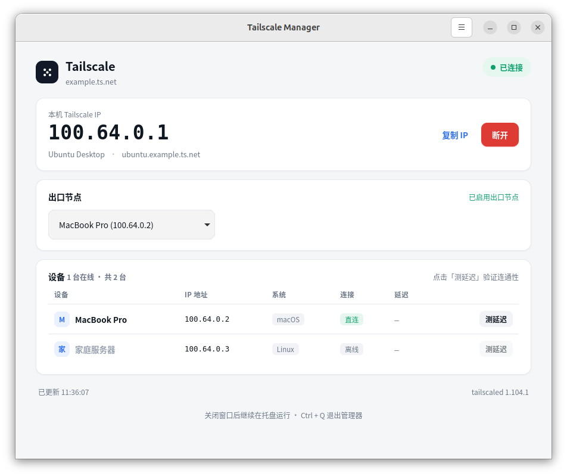

# Tailscale Manager

非官方的 Linux Tailscale 图形管理器：独立窗口、顶栏托盘、可选登录自启动。
关闭窗口后仍在托盘运行，重复启动会唤回已有窗口。



## 安装

面向 Ubuntu 24.04 / Debian 系桌面。从 [最新发布版本](https://github.com/llllllhui/tailscale-manager/releases/latest)
下载 `tailscale-manager_0.2.0_all.deb`，然后在下载目录执行：

```bash
sudo apt install ./tailscale-manager_0.2.0_all.deb
```

安装器会安装 GTK、WebKit 和 Ayatana 托盘组件。随后在应用列表搜索
**Tailscale 管理器**，或运行 `tailscale-manager`。

Tailscale 本身需要事先安装并启动；支持系统包和 Homebrew 安装的 CLI。
本应用沿用已有 Tailscale 登录和网络设置。

## 日常使用

- **窗口**：连接／断开、复制 IP、查看设备、切换出口节点、测延迟。
- **托盘菜单**：查看状态、连接／断开、复制 IP、切换出口节点、打开窗口。
- **登录后自动启动**：在托盘或窗口右上角菜单中勾选，后台启动不弹出窗口。
- **关闭窗口 / Ctrl+W**：隐藏到托盘。桌面不支持托盘时正常退出。
- **退出管理器 / Ctrl+Q**：退出图形应用，Tailscale 的网络连接继续由守护进程维持。
- **需要登录时**：点击登录按钮，在默认浏览器中完成授权。

开启本应用自启动时，会备份并停用旧的
`~/.config/autostart/tailscale-systray.desktop`，避免下次登录出现两个托盘。
备份文件为 `tailscale-systray.desktop.before-manager`；如要恢复官方托盘，可复制回原文件名。

如果普通用户没有控制权限，界面会给出具体提示。一次性授权示例：

```bash
sudo /home/linuxbrew/.linuxbrew/bin/tailscale set --operator="$USER"
```

请使用本机实际的 Tailscale 路径；不要将 Homebrew 二进制软链到 `/usr/local/bin`。

## 从源码运行与打包

```bash
sudo apt install python3-gi gir1.2-gtk-3.0 gir1.2-webkit2-4.1 gir1.2-ayatanaappindicator3-0.1
./bin/tailscale-manager
bash build-deb.sh
```

安装包生成在 `dist/`，可以使用 `sudo apt install ./dist/tailscale-manager_0.2.0_all.deb` 安装。

GNOME 桌面还需要托盘扩展（Ubuntu 默认通常已有）：

```bash
sudo apt install gnome-shell-extension-appindicator
```

也可在依赖齐全后执行 `bash install.sh`，安装到当前用户的
`~/.local/share/tailscale-manager` 和 `~/.local/bin`。
用户安装会复制实际文件，安装后不再依赖源码目录。
更新用户安装时重新执行安装脚本。

卸载系统安装：`sudo apt remove tailscale-manager`。
卸载用户安装：先退出管理器，再删除 `~/.local/share/tailscale-manager`、
`~/.local/bin/tailscale-manager`、`~/.local/share/applications/io.github.tailscalemanager.Manager.desktop`
和 `~/.local/share/icons/hicolor/scalable/apps/tailscale-manager.svg`。
两种安装的用户设置位于 `~/.config/tailscale-manager`，自启动项位于
`~/.config/autostart/tailscale-manager.desktop`。卸载后可一并删除。
路径遵循 XDG 配置，若自定义了 XDG 环境变量，以对应目录为准。

## 结构

| 文件 | 用途 |
| --- | --- |
| `desktop.py` | GTK 单实例应用、WebKit 消息桥、托盘与窗口生命周期 |
| `desktop_settings.py` | 窗口大小、自启动及旧托盘配置迁移 |
| `server.py` | Tailscale CLI 状态与操作；也保留开发用 HTTP 服务 |
| `ui.html` | 中文管理界面、深色模式、窗口尺寸适配 |
| `packaging/` | Debian 包元信息和桌面入口 |
| `build-deb.sh` | 生成 `dist/tailscale-manager_0.2.0_all.deb` |
| `install.sh` | 当前用户安装器 |

桌面版不监听 HTTP 端口。界面通过 WebKit 消息桥访问应用，CLI 操作在工作线程执行，
退出应用时一并结束。安装目录可只读，运行时不在源码或安装目录写文件。

`python3 server.py` 仍可启动旧开发用 HTTP 界面。它只绑定 `127.0.0.1`，
**没有本地用户鉴权**，仅用于可信的单用户开发环境；桌面版不使用该服务。

## 验证

```bash
/usr/bin/python3 -m unittest discover -s tests -v
/usr/bin/python3 tests/smoke_desktop.py
# 无托盘宿主场景（仍需要可用的图形显示器）：
dbus-run-session -- /usr/bin/python3 tests/smoke_desktop.py --without-tray
```

桌面检查使用替身后端，验证界面桥接、托盘操作、复制、关窗、单实例、登录跳转和自启动，
不会切换本机实际的 VPN。默认保存窗口截图到 `/tmp/tailscale-manager-desktop.png`。
